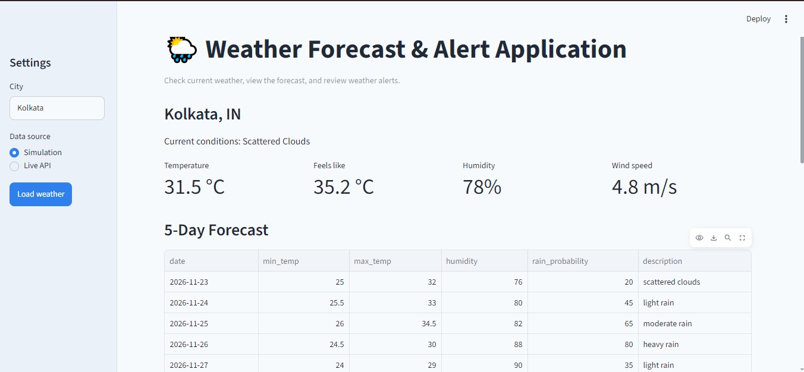
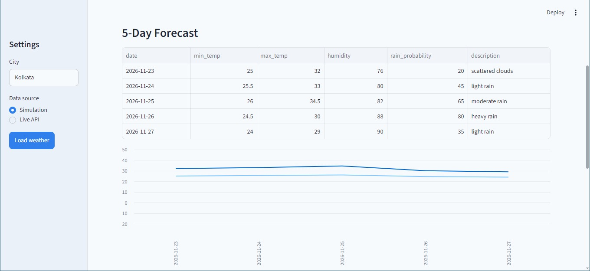
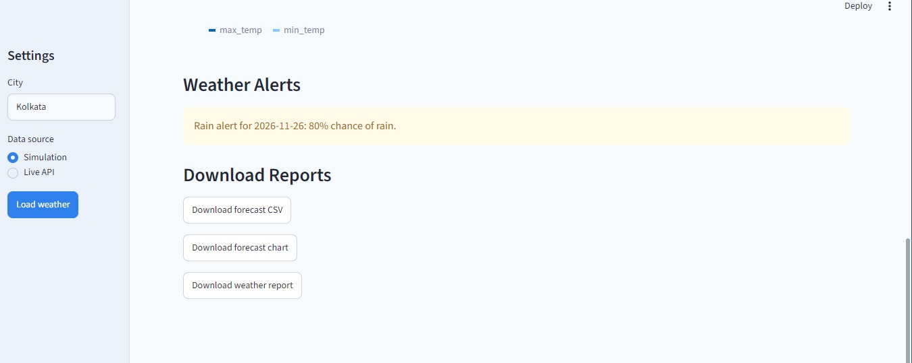
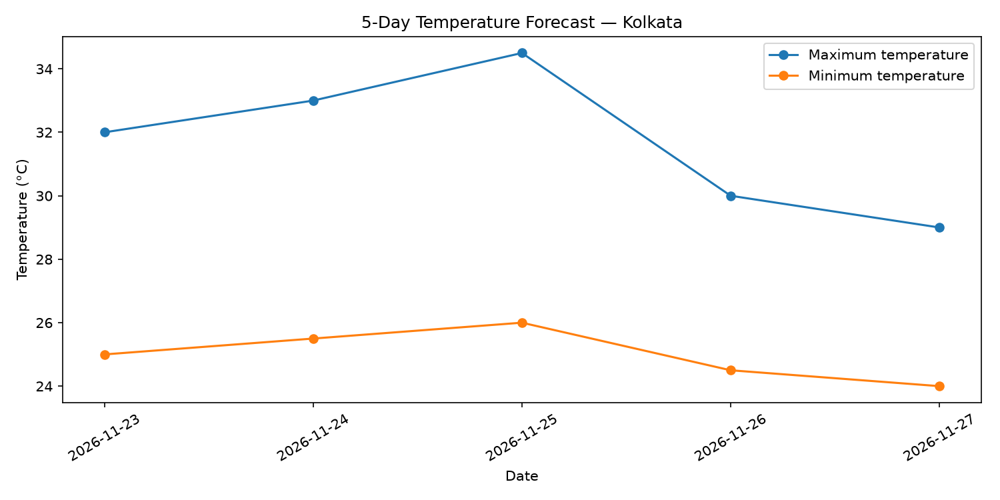

# 🌦️ Weather Forecast & Alert Application

A Python-based weather application that displays current weather conditions, presents a 5-day forecast, and generates weather alerts. It includes a command-line interface and an interactive Streamlit dashboard, with both sample-data simulation and live weather API modes.

## 📌 Project Overview

The Weather Forecast & Alert Application lets users explore weather conditions for a selected city.

- **Simulation mode:** Uses local sample data without requiring an API key.
- **Live API mode:** Fetches current weather and forecast data from OpenWeatherMap.

## ✨ Features

- Current temperature, feels-like temperature, humidity, wind speed, and conditions
- 5-day forecast with daily minimum and maximum temperatures
- Rule-based alerts for high temperatures, high humidity, and likely rain
- Interactive Streamlit dashboard with weather metrics, forecast table, and chart
- Simulation mode using local sample data
- Live weather data through OpenWeatherMap
- Downloadable forecast CSV, chart image, and text report
- Command-line interface for running the application from the terminal

## 🖥️ Dashboard Preview



## 📸 Project Screenshots

### 5-Day Weather Forecast



### Weather Alerts



### Forecast Temperature Chart



### Project Folder Structure


## 🧰 Tech Stack

- Python
- Streamlit
- Requests
- python-dotenv
- Pandas
- Matplotlib
- OpenWeatherMap API

## 📁 Project Structure

```text
Weather-Forecast-Alert-Application/
├── .streamlit/
│   └── config.toml
├── data/
│   └── sample_weather.json
├── docs/
├── images/
│   ├── five_day_forecast.png
│   ├── forecast_chart.png
│   ├── project folder.png
│   ├── project_dashboard.png
│   └── weather_alerts.png
├── outputs/
├── reports/
│   └── weather_report.txt
├── src/
│   ├── __init__.py
│   ├── alert_system.py
│   ├── report_generator.py
│   ├── weather_analysis.py
│   └── weather_api.py
├── .env.example
├── .gitignore
├── app.py
├── main.py
├── README.md
└── requirements.txt
```

## ⚙️ Installation and Setup

### 1. Clone the repository

```bash
git clone <your-repository-url>
cd Weather-Forecast-Alert-Application
```

### 2. Create and activate a virtual environment

```bash
python -m venv .venv
```

**Windows PowerShell:**

```powershell
.\.venv\Scripts\Activate.ps1
```

### 3. Install dependencies

```bash
pip install -r requirements.txt
```

### 4. Configure the API key

Simulation mode works without an API key. To use Live API mode:

1. Create an account at [OpenWeatherMap](https://openweathermap.org/api).
2. Obtain an API key.
3. Create a `.env` file in the project root.
4. Add your key:

```env
OPENWEATHER_API_KEY=your_api_key_here
```

Keep your actual `.env` file private. Do not upload it to GitHub.

## 🚀 Running the Application

### Run the command-line application

```bash
python main.py
```

Enter a city when prompted. Choose `n` for Simulation mode or `y` for Live API mode.

### Run the Streamlit dashboard

```bash
streamlit run app.py
```

Choose a data source in the sidebar, enter a city, and click **Load weather**.

## 🧪 Simulation Mode

Simulation mode uses the local file `data/sample_weather.json`.

The sample dataset currently includes:

- Kolkata
- Delhi
- Mumbai
- Chennai

These are illustrative sample values, not live weather readings. Additional cities can be added to the JSON file using the same data structure.

## 🌐 Live Weather Mode

Live API mode uses OpenWeatherMap to retrieve current weather and forecast data for the city entered by the user.

The forecast API provides readings at 3-hour intervals. The application groups those readings into daily summaries for the forecast display.

Live weather access requires a valid API key and an internet connection.

## 📊 Generated Files

| File | Description |
|---|---|
| `outputs/weather_forecast.csv` | Forecast data in CSV format |
| `outputs/forecast_chart.png` | Temperature forecast chart |
| `reports/weather_report.txt` | Text report with current conditions, forecast, and alerts |

## 🔐 Security

- Store your API key in `.env`.
- Keep `.env` excluded from version control.
- Do not publish API keys in screenshots, source code, or README files.
- Upload `.env.example` without a real API key.

## 🔮 Future Improvements

- Add more cities to the simulation dataset
- Add city search suggestions and input validation
- Add configurable alert thresholds
- Add weather icons and improved forecast visualizations
- Add historical weather tracking
- Add automated tests for API, alert, and report functions

## 🎯 Learning Outcomes

This project provides practical experience with:

- Calling external APIs and handling responses
- Working with JSON and environment variables
- Organizing Python code into modules
- Processing data with Pandas
- Creating visualizations with Matplotlib
- Building an interactive dashboard with Streamlit
- Generating downloadable reports and files

## 👩‍💻 Author

**Tirtha Sen**

A portfolio project focused on Python, data handling, API integration, and interactive application development.

